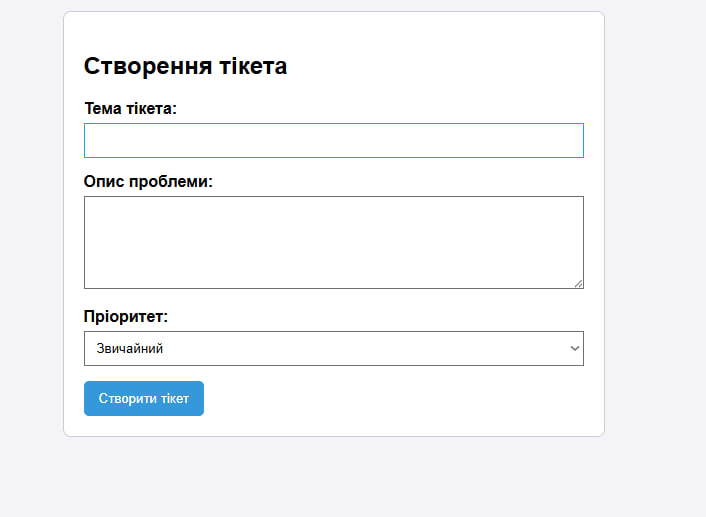

# Практична робота №2. Взаємодія вебзастосунку з користувачем: форми, валідація, локальне сховище

**Виконав:** Сизоненко Артем Олександрович  
**Група:** ІО-45

## Опис завдання
Мета роботи — навчитися обробляти дані HTML-форм у PHP, реалізувати серверну та клієнтську (JS) валідацію введених даних, а також зберігати чернетки за допомогою `localStorage` браузера.

**Варіант 19: Система тікетів служби підтримки (helpdesk)**
*   **Поля форми:** `subject` (тема), `description` (опис проблеми), `priority` (пріоритет - випадаючий список).
*   **Валідація:**
    * Тема є обов'язковою.
    * Опис (`description`) має містити не менше 15 символів (перевіряється на клієнті через JS та на сервері через PHP).
    * Пріоритет (`priority`) перевіряється на відповідність списку дозволених значень.
*   **Локальне сховище (localStorage):** скрипт автоматично зберігає чернетку опису тікета під час введення і відновлює її після перезавантаження сторінки. Після успішного створення тікета чернетка видаляється.

## Результат роботи
Скріншот розробленої форми:



## Інструкція із запуску
1. Клонувати репозиторій на локальний комп'ютер.
2. Відкрити термінал у папці з проєктом.
3. Запустити вбудований PHP-сервер командою:
   ```bash
   php -S localhost:8000